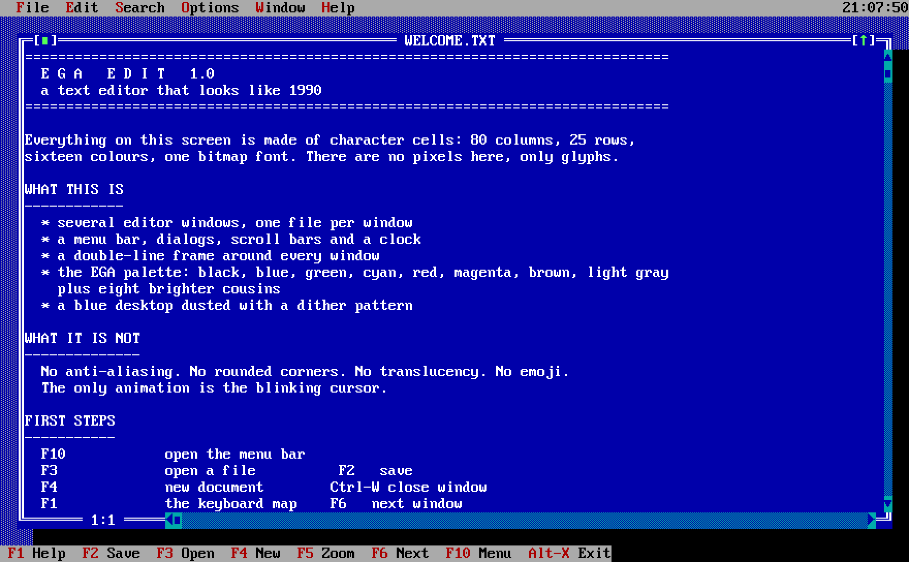
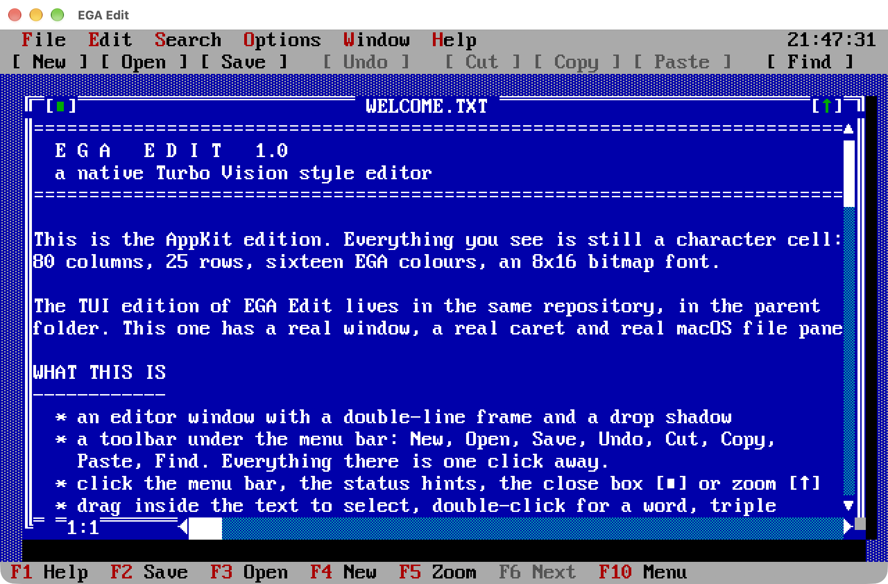
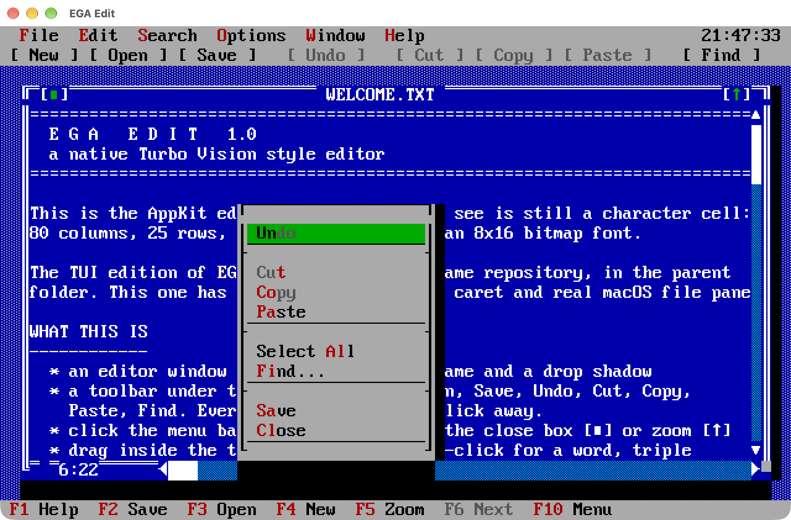
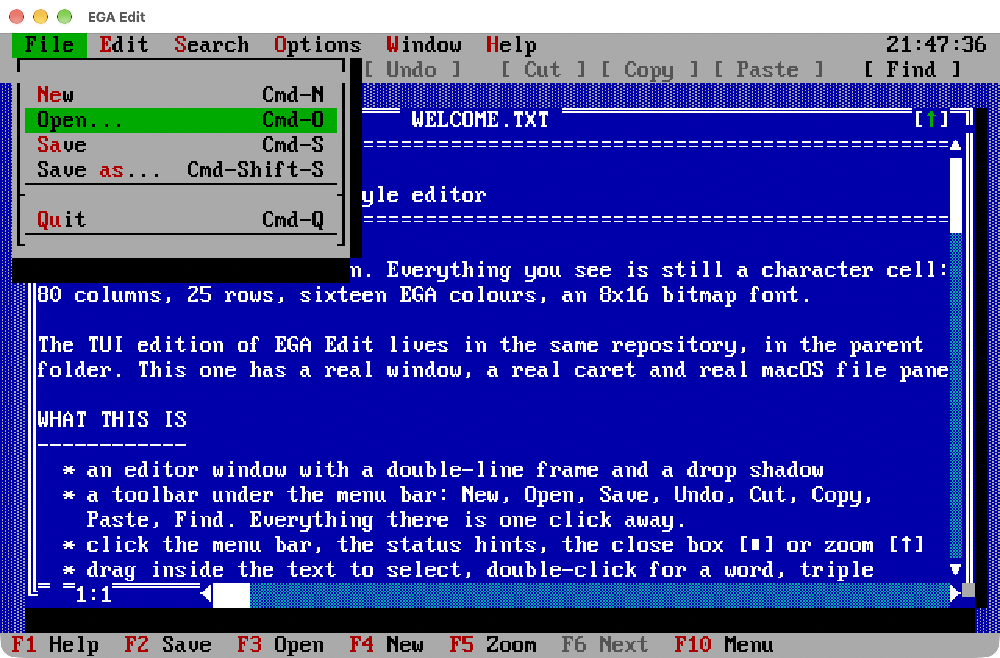
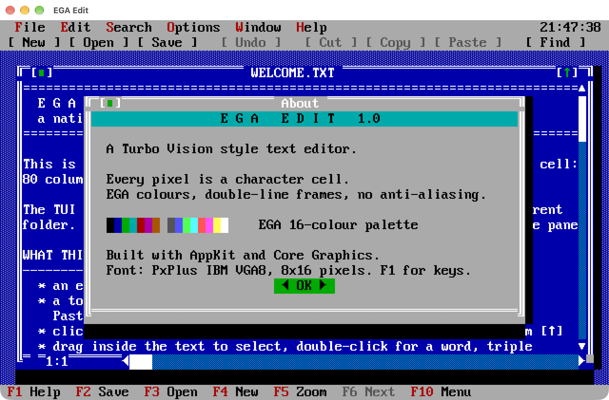

# EGA EDIT

**A Turbo Vision style text editor, in two editions.**

| Edition | What it is | Where |
|---|---|---|
| **EGA EDIT (TUI)** | Native terminal program, C++17 + [magiblot/tvision](https://github.com/magiblot/tvision) | `src/`, built to `build/bin/egaedit` |
| **EGA Edit.app** | Native macOS window application, Swift + AppKit + Core Graphics | `native/`, built to `native/EGA Edit.app` |

Both draw the same thing: an 80×25 grid of character cells, EGA 16 colours,
double-line windows, a dotted blue desktop and an 8×16 bitmap font.

[Design spec](docs/style-guide.md)

---

## TUI edition



```sh
cmake -S . -B build -DCMAKE_BUILD_TYPE=Release
cmake --build build -j
./run.sh                 # opens WELCOME.TXT
./run.sh notes.txt
```

On startup the program rewrites the terminal's 16 ANSI colours to the canonical
EGA values with `OSC 4`, and restores them on exit. Opt out with `TVEGA=0`.

| Key | Action | Key | Action |
|---|---|---|---|
| `F1` | Keyboard map | `F2` / `Ctrl-S` | Save |
| `F3` / `Ctrl-O` | Open | `F4` / `Ctrl-N` | New window |
| `F5` | Zoom | `F6` | Next window |
| `F10` | Menu bar | `Alt-X` / `Ctrl-Q` | Quit |
| `Ctrl-Z` | Undo | `Ctrl-X/C/V` | Cut / copy / paste |
| `Ctrl-A` | Select all | `Ctrl-F/H/L` | Find / replace / again |
| `Ctrl-W` | Close window | `Tab` | Move focus |

More screens: [menu](docs/screenshot-menu.png), [find](docs/screenshot-find.png),
[keyboard](docs/screenshot-keys.png), [palette](docs/screenshot-palette.png).

---

## Native edition



A real macOS application, and it is **mouse-first**: every command has a
button, a menu entry or a click target. Shortcuts still work, but they are
optional.

- A **toolbar** under the menu bar: New, Open, Save, Undo, Cut, Copy, Paste, Find
- Click the menu bar, the clickable status hints, `[■]` to close, `[↑]` to zoom
- **Drag to select**; double-click selects a word, triple-click a line
- **Right-click** the text for a context menu (cut, copy, paste, find, save, close)
- Drag scroll-bar thumbs, click tracks and arrows, or use the scroll wheel
- Drag the **bottom-right corner** to resize a window; double-click its title to zoom
- **File → recent files**: the last five documents, one click each
- Native Open/Save panels, the system clipboard, a blinking caret
- Hover highlights, pointing-hand/beam/resize cursors, whole-pixel Retina scaling

```sh
cd native
./build.sh                  # builds "EGA Edit.app"
open "EGA Edit.app"
```

Or double-click `native/EGA Edit.app` in Finder. The app is self-contained:
the pre-rendered glyph atlas and the welcome text live in its Resources.

Keyboard is optional, but everything is also bound:

| Key | Action | Key | Action |
|---|---|---|---|
| `Cmd-N` | New window | `Cmd-O` | Open |
| `Cmd-S` | Save | `Cmd-Shift-S` | Save as |
| `Cmd-W` | Close window | `Cmd-Q` | Quit (asks to save) |
| `Cmd-Z` | Undo | `Cmd-X/C/V` | Cut / copy / paste |
| `Cmd-A` | Select all | `Cmd-F/R/G` | Find / replace / again |
| `F1` | Keyboard map | `F10` | Menu bar |
| `F5` | Zoom | `F6` | Next window |

Everything in the chrome is drawn by the app itself — the toolbar, the menus,
the context menu and the dialogs:







---

## How the look is made

- **Double-line frames** — the vendored `TFrame::frameChars` table is patched so
  passive windows use the double-line glyphs too. The native app draws its own
  boxes from the same character set.
- **Blue dotted desktop** — stock Turbo Vision paints gray with blue dots;
  both editions draw a light gray `░` dither on EGA blue.
- **One-cell black shadow** — `shadowSize = {1,1}`, `shadowAttr = 0`.
- **EGA palette** — injected into the terminal with `OSC 4`; the native app
  simply paints the exact RGB values.
- **8×16 glyphs** — the native app ships a pre-rendered CP437 atlas
  (`native/Resources/glyphs.bin`) generated from PxPlus IBM VGA8, so it needs
  no font at runtime and every glyph is pixel-exact. The TUI edition uses the
  terminal's own font.
- **Modern Ctrl/Cmd bindings** — Turbo Vision's WordStar-era key bindings are
  removed; the shortcuts above are bound on the status line (TUI) or in the
  responder chain (native), and the native edition adds a mouse-first toolbar,
  context menu, draggable scroll bars and resizable windows.

The native edition is a fixed 80×25 character grid; the window can be resized
and the grid scales by whole pixel multiples. Its atlas covers ASCII and the
CP437 symbols; characters outside that set render as `?`. For arbitrary UTF-8,
use the TUI edition and let the terminal handle the font.

---

## Layout

```
README.md                 this file
LICENSE                   MIT licence
THIRD_PARTY_NOTICES.md    licences of bundled assets
docs/style-guide.md       the Turbo Vision design spec
docs/screenshot-*.png     TUI previews
docs/native-*.png         native app previews
run.sh                    launch the TUI from the project root
src/                      TUI sources (main, app, dialogs)
vendor/tvision/           magiblot/tvision (with the patches below)
native/
  build.sh                builds "EGA Edit.app"
  Sources/                Swift sources (screen, renderer, model, view)
  Resources/              glyph atlas, welcome text, icon, Info.plist
  tools/                  atlas and icon generators
tools/                    TUI screenshot tools + the VGA font (docs only)
WELCOME.TXT               TUI opening buffer
```

Vendored patches (all in `vendor/tvision/source/tvision/`):

1. `tvtext1.cpp` — passive frame characters are double-line; drag grips use
   UTF-8 box glyphs
2. `teditor1.cpp` — WordStar Ctrl-key bindings removed
3. `tfillist.cpp` — `/` instead of `\` in Unix file listings

---

## Licence

The application code is MIT licensed — see [LICENSE](LICENSE). Bundled assets
keep their own licences; see [THIRD_PARTY_NOTICES.md](THIRD_PARTY_NOTICES.md).

## Credits

- [Turbo Vision](https://github.com/magiblot/tvision) by Borland, modernised by
  magiblot. The vendored copy keeps Borland's public licence, see
  `vendor/tvision/COPYRIGHT`.
- [PxPlus IBM VGA8](https://int10h.org/oldschool-pc-fonts/) by VileR, CC BY-SA
  4.0. Used to generate the native glyph atlas (`native/tools/make_glyphs.py`)
  and to render the screenshots. The font file lives in `tools/fonts/`; the
  generated atlas is distributed under the same licence.
